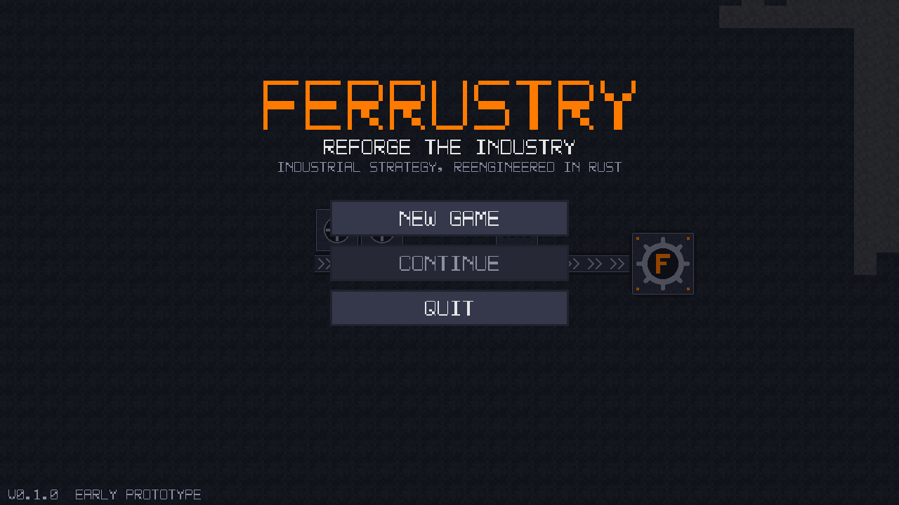
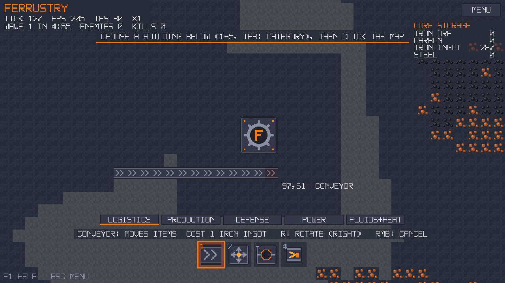
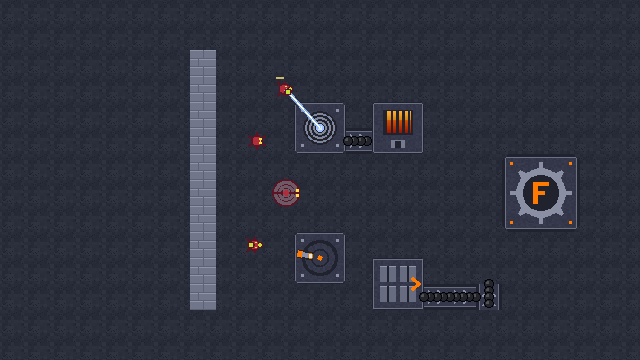

# Ferrustry

**Reforge the Industry.** Industrial strategy, reengineered in Rust.

[Русский](README.md) · English

Ferrustry is an original open-source factory automation + base defense game
in Rust: its own engine, a headless fixed-timestep simulation, a dedicated server
and a focus on measurable performance of large bases.

> Status: **v0.4, an early playable version.** Map generation, production, power, heat, combat with
> waves of four enemy types, schematics, saves and replays. The balance is not tuned yet.
> What changed: see the [changelog](CHANGELOG.en.md).







## Quick start

```bash
cargo run --release -p ferrustry-client
```

**NEW GAME** → choose the map size, difficulty and seed → **START**. You start with a core and 300
ingots; ore and carbon are nearby, and enemies arrive from the map edges in a few minutes.

First chain: a **bore** on ore → **conveyor** → **smelter** (two **wind turbines** next to it) → conveyor → **core**.
Pick buildings on the bottom panel (click or **1–5**, **Tab** switches the tab), place them with a click,
drag to build a line. **F1** in the game lists the keys.

How production, power, heat, combat and schematics work: the **[player guide](docs/en/player-guide.md)**;
every building and enemy number: the **[content reference](docs/en/content-reference.md)**.

Requirements: a CPU with AVX2 (x86_64) or Apple Silicon; a GPU with Vulkan, DirectX 12 or
Metal. On Linux, `libvulkan1` and `libxkbcommon-x11-0` are needed.

Without a window:

```bash
cargo run --release -p ferrustry-headless -- run
```

## Layout

| Crate | Purpose |
|---|---|
| `ferrustry-content` | Content schema (RON), validation, registry, reference generation |
| `ferrustry-sim` | Deterministic simulation: world, logistics, power, heat, combat, map generator, schematics |
| `ferrustry-format` | Save, replay and schematic files |
| `ferrustry-headless` | Scenario runs, benchmarks, replay, save checks |
| `ferrustry-render` | 2D wgpu renderer: procedural atlas, instanced sprites, camera |
| `ferrustry-client` | The game: window (winit), input, building, UI |

## Documentation

For players:
- [Player guide](docs/en/player-guide.md)
- [Content reference](docs/en/content-reference.md) — generated from the game data
- [Changelog](CHANGELOG.en.md)

For developers and content authors:
- [Development](docs/en/development/README.md) and [testing](docs/en/development/testing.md)
- [Content format](docs/en/content-format.md) — how to add a building or an enemy
- [Balance report](docs/en/balance/2026-11-19-normal.md) — the difficulty curve from real runs
- [Architecture](docs/en/architecture.md)
- [Genre analysis](docs/en/genre-analysis.md)
- [Compatibility](docs/en/compatibility.md)
- [Roadmap and backlog](docs/en/roadmap.md)
- [Performance](docs/en/performance.md)
- [Licensing](docs/en/licensing.md)
- [Decisions for approval](docs/en/decisions.md)

## License

Code: MIT OR Apache-2.0 at your option ([LICENSE-MIT](LICENSE-MIT), [LICENSE-APACHE](LICENSE-APACHE)).
Asset and brand policy: [docs/en/licensing.md](docs/en/licensing.md).
