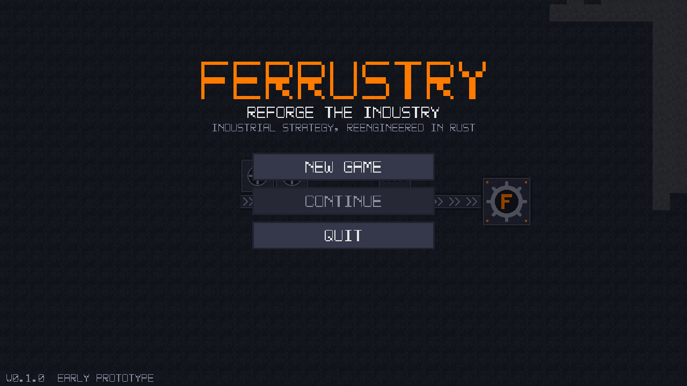
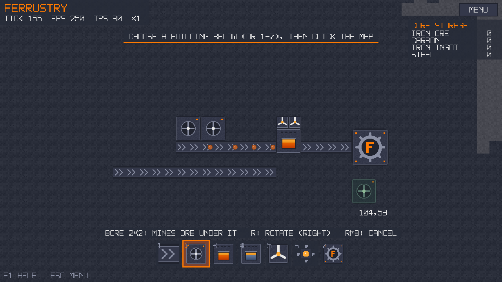

# Ferrustry

**Reforge the Industry.** Industrial strategy, reengineered in Rust.

Ferrustry — оригинальная open-source игра жанра «автоматизация производства + защита базы»
на Rust: собственный движок, headless-симуляция с фиксированным шагом, выделенный сервер
и упор на измеримую производительность больших баз.

> Статус: **этап 2 — первый графический клиент.** Ядро симуляции, сохранения, replay, бенчмарки и окно с камерой и стройкой мышью.





## Быстрый старт

```bash
cargo run --release -p ferrustry-client
```

Игра открывается главным меню: **NEW GAME** — новая карта, **CONTINUE** — быстрое сохранение.

Как строить: выберите постройку на панели внизу (клик или **1–5**, **Tab** — вкладка) и кликните по карте;
протяжка ЛКМ строит линию лент уголком. **ПКМ** — снять инструмент, протяжка ПКМ — снос рамкой,
**R** — поворот, **WASD/стрелки/СКМ** — камера, **колесо** — масштаб, **Пробел** — пауза,
**+/−** — скорость, **F5/F9** — быстрое сохранение/загрузка, **F1** — справка, **Esc** — меню.

Клик по постройке без инструмента открывает **инспектор** (буферы, прогресс, энергия; у сортировщика — выбор фильтра).
Стройка стоит ресурсов из ядра (стартовый запас — 150 слитков), при сносе ресурсы возвращаются.

Первая цепочка: бур на руде → лента → плавильня (рядом ветряк) → лента → ядро.
Логистика: разветвитель, сортировщик, мост над препятствиями; энергия: ветряки, узлы, батареи.
Тепло: кузница стали греется и выше 70% замедляется (постройка краснеет) — охлаждайте радиаторами,
градирней (вода из конденсатора по трубам) или тепловой машиной, которая превращает тепло в энергию.
Постройки сгруппированы во вкладки; **Tab** — следующая вкладка, **1–5** — постройка во вкладке.
Бой: через 5 минут с краёв карты приходят волны врагов (каждые 2 минуты, всё больше). Ставьте турели
(вкладка DEFENSE) и подавайте им слитки лентой; стены враги предпочитают обходить. Разрушение
последнего ядра — поражение.

Требования: процессор с AVX2 (x86_64) или Apple Silicon; видеокарта с Vulkan, DirectX 12 или
Metal. На Linux нужны `libvulkan1` и `libxkbcommon-x11-0`.

Без окна:

```bash
cargo run --release -p ferrustry-headless -- run
```

## Структура

| Крейт | Назначение |
|---|---|
| `ferrustry-content` | Схема контента (RON), валидация, реестр |
| `ferrustry-sim` | Детерминированная симуляция: мир, постройки, конвейеры, энергия, производство |
| `ferrustry-format` | Форматы сохранений и replay v1.0 |
| `ferrustry-headless` | Прогон сценариев, бенчмарки, replay, проверка сохранений |
| `ferrustry-render` | 2D-рендерер на wgpu: процедурный атлас, instanced-спрайты, камера |
| `ferrustry-client` | Игра: окно (winit), ввод, стройка, интерфейс |

## Документация

- [Разработка](docs/development/README.md)

- [Архитектура](docs/architecture.md)
- [Анализ жанра](docs/genre-analysis.md)
- [Совместимость](docs/compatibility.md)
- [Roadmap и backlog](docs/roadmap.md)
- [Производительность](docs/performance.md)
- [Лицензирование](docs/licensing.md)
- [Решения на согласование](docs/decisions.md)

## Лицензия

Код — MIT OR Apache-2.0 на выбор ([LICENSE-MIT](LICENSE-MIT), [LICENSE-APACHE](LICENSE-APACHE)).
Политика для ассетов и бренда — [docs/licensing.md](docs/licensing.md).
