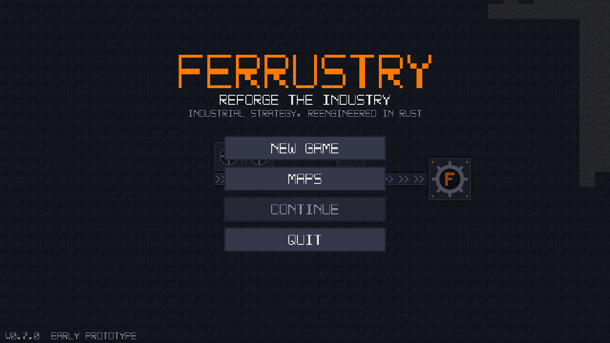
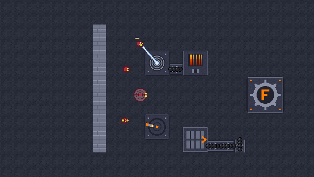
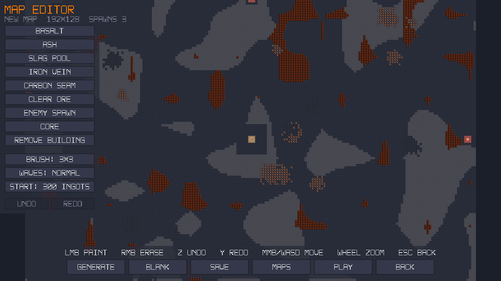

# Ferrustry

**Reforge the Industry.** Industrial strategy, reengineered in Rust.

Русский · [English](README.en.md)

Ferrustry — оригинальная open-source игра жанра «автоматизация производства + защита базы»
на Rust: собственный движок, headless-симуляция с фиксированным шагом, выделенный сервер
и упор на измеримую производительность больших баз.

> Статус: **v0.7, ранняя играбельная версия.** Генерация карт и редактор карт, производство, энергия,
> тепло, бой с волнами четырёх видов врагов, шум базы, схемы, сохранения и replay. Баланс — первый проход
> по замерам.
> Что изменилось — в [журнале изменений](CHANGELOG.md).








## Быстрый старт

```bash
cargo run --release -p ferrustry-client
```

**NEW GAME** → выберите размер карты, сложность и seed → **START**. Вы начинаете с ядром и 300
слитками; руда и уголь — рядом, враги придут с краёв карты через несколько минут.

Первая цепочка: **бур** на руде → **лента** → **плавильня** (рядом два **ветряка**) → лента → **ядро**.
Постройки выбираются на панели внизу (клик или **1–6**, **Tab** — вкладка), ставятся кликом,
протяжка строит линию. **F1** в игре — список клавиш. Свою карту можно нарисовать в редакторе: **MAPS** → **NEW MAP**.

Как работает производство, энергия, тепло, бой и схемы — в **[руководстве игрока](docs/player-guide.md)**;
все числа построек и врагов — в **[справочнике контента](docs/content-reference.md)**.

Требования: процессор с AVX2 (x86_64) или Apple Silicon; видеокарта с Vulkan, DirectX 12 или
Metal. На Linux нужны `libvulkan1` и `libxkbcommon-x11-0`.

Сетевая игра — сервер и подключение к нему (подробнее — в [руководстве](docs/player-guide.md#сетевая-игра)):

```bash
cargo run --release -p ferrustry-server
```

```bash
cargo run --release -p ferrustry-client -- --connect 192.168.1.10
```

Без окна:

```bash
cargo run --release -p ferrustry-headless -- run
```

## Структура

| Крейт | Назначение |
|---|---|
| `ferrustry-content` | Схема контента (RON), валидация, реестр, генерация справочника |
| `ferrustry-sim` | Детерминированная симуляция: мир, логистика, энергия, тепло, бой, генератор карт, схемы |
| `ferrustry-format` | Файлы сохранений, карт, replay и схем |
| `ferrustry-net` | Сетевая игра: протокол, сервер и клиент с рассылкой команд (этап 6) |
| `ferrustry-server` | Выделенный сервер сетевой игры (UDP) |
| `ferrustry-headless` | Прогон сценариев, бенчмарки, replay, проверка сохранений и карт, отчёт о балансе |
| `ferrustry-render` | 2D-рендерер на wgpu: процедурный атлас, instanced-спрайты, камера |
| `ferrustry-client` | Игра: окно (winit), ввод, стройка, интерфейс |

## Документация

Игрокам:
- [Руководство игрока](docs/player-guide.md)
- [Справочник контента](docs/content-reference.md) — генерируется из данных игры
- [Журнал изменений](CHANGELOG.md)

Разработчикам и авторам контента:
- [Разработка](docs/development/README.md) и [тестирование](docs/development/testing.md)
- [Формат контента](docs/content-format.md) — как добавить постройку или врага
- [Отчёт о балансе](docs/balance/2026-11-19-normal-tuned.md) — кривая сложности из прогонов ([до настройки](docs/balance/2026-11-19-normal.md))
- [Архитектура](docs/architecture.md)
- [Сетевая игра: проект](docs/network-design.md) — этап 6
- [Анализ жанра](docs/genre-analysis.md)
- [Совместимость](docs/compatibility.md)
- [Roadmap и backlog](docs/roadmap.md)
- [Производительность](docs/performance.md)
- [Лицензирование](docs/licensing.md)
- [Решения на согласование](docs/decisions.md)

## Лицензия

Код — MIT OR Apache-2.0 на выбор ([LICENSE-MIT](LICENSE-MIT), [LICENSE-APACHE](LICENSE-APACHE)).
Политика для ассетов и бренда — [docs/licensing.md](docs/licensing.md).
